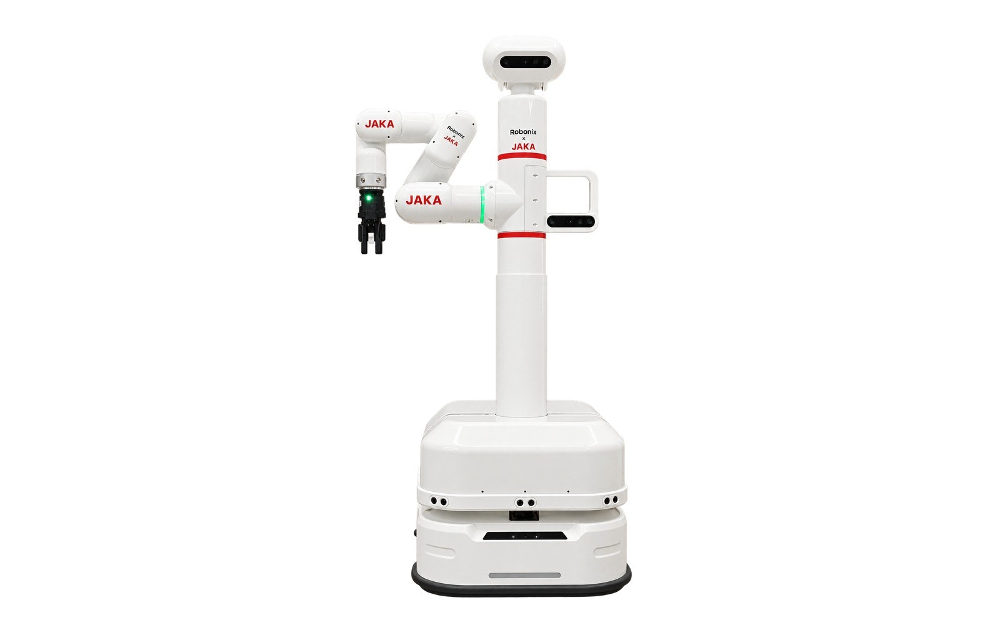

# robot-jaka-lumi_with_tg9801_gripper

Robonix deployment repository for the JAKA Lumi (12-DOF mobile manipulator with
a TG-9801 gripper).



```text
robot-jaka-lumi_with_tg9801_gripper/
├── robonix_manifest.yaml          committed form: every package referenced by url
├── robonix_manifest.local.yaml    machine-local form: `path:` to sibling checkouts (gitignored)
├── soma.yaml                      body description, footprint, logical component tree
├── urdf/jaka_lumi.urdf            whole-robot tree (27 links / 26 joints, 10 movable)
├── urdf/meshes/*.STL              26 meshes, 17 MB
├── config/rtabmap_params.yaml     RGB-D mapping parameters
├── config/nav2_params.yaml        Nav2 parameters (the no-scan trade-off is documented in the header)
├── assets/robot.jpg               robot listing preview for the Robonix package catalog (not a build input)
├── tools/prepare_urdf.py          generates the URDF above from the vendor model (re-runnable)
├── tools/check_deployment.py      static self-check: manifest / soma / URDF / params / env
├── build.sh / start.sh            build and start entry points
├── .vlmkey.example                template for the VLM credentials and the head camera serial
└── README.md
```

## Deployment instances

| Instance | Source | Role |
|---|---|---|
| `lumi_chassis` | **new** `primitive-jaka-lumi-chassis-rbnx` | base: odom + move + `/cmd_vel`, vendor TCP JSON :31001 |
| `lumi_body` | **new** `primitive-jaka-lumi-body-rbnx` | lift/waist/head joints → `/joint_states`, vendor HTTP :5000 |
| `jaka_arm` | **reused** `primitive-jaka-mini_with_tg9801_gripper-arm_gripper-rbnx` | 6-axis arm + TG-9801 (same Mini 2, same gripper) |
| `head_camera` | **reused** `primitive-orbbec-camera-rbnx` | head Gemini 2L (`gemini2L.launch.py`) |
| `robot_description` | **reused** `primitive-robot-description-rbnx` | reads the URDF from Soma, runs robot_state_publisher for TF |
| `mapping` | **reused** `service-map-rbnx` | RTAB-Map RGB-D mapping, occupancy grid and `map→odom` |
| `navigation` | **reused** `service-navigation-rbnx` | Nav2 bound to map + odom, publishes `/cmd_vel` |

## Deployment topology (read this first)

The two Lumi RGB-D cameras are **USB devices attached to the robot's internal
computer**, not to the workstation. A primitive has no way to reach USB across
machines, so what can run where differs:

| Instance | Workstation (WiFi access) | Internal computer (camera host) | Reason |
|---|---|---|---|
| `lumi_chassis` | ✅ | ✅ | TCP `192.168.10.10:31001` |
| `lumi_body` | ✅ | ✅ | HTTP `192.168.10.90:5000` |
| `jaka_arm` | ✅ | ✅ | jkrc `192.168.10.90` |
| `robot_description` (TF) | ✅ | ✅ | only needs `/joint_states` |
| `head_camera` | ❌ no USB here | ✅ | camera is physically attached there |
| `mapping` | ❌ | ✅ | needs camera rgb+depth |
| `navigation` | ❌ | ✅ | needs `service/map` (provided by mapping) |

Three topologies; pick one according to the goal:

1. **Install everything on the internal computer** — the only complete option
   when you need mapping + Nav2. Copy or clone this repository and the six
   packages onto that machine, install `ros-humble-rtabmap-ros`,
   `ros-humble-nav2-bringup` and Robonix, then
   `bash build.sh && bash start.sh`.
2. **Split across machines**: the workstation runs the three control instances
   plus `robot_description`, the internal computer runs `head_camera` +
   `mapping`, and both talk to the same Atlas
   (`system.atlas.listen: 0.0.0.0:50051`) and the same Zenoh router
   (`ROBONIX_ZENOH_ROUTER=tcp://<workstation-ip>:7447`). Highest operational cost:
   cross-machine DDS plus two Robonix installs.
3. **Workstation, control only** (ready on this machine): use
   `robonix_manifest.control.yaml`, which declares four instances
   (`robot_description` / `jaka_arm` / `lumi_chassis` / `lumi_body`).
   This is enough to accept the **whole TF design** — `lumi_body` publishes
   `l_1..l_4`, so `robot_state_publisher` derives
   `base_link → … → Camera3_Link` even though no image ever arrives.

   ```bash
   python3 tools/check_deployment.py -m robonix_manifest.control.yaml --partial
   bash start.sh robonix_manifest.control.yaml
   ```

   (That manifest is a machine-local file and is gitignored; recreate it from the
   four instances above.)

## Hardware addresses

| Part | Interface |
|---|---|
| Arm (JAKA Mini 2) | jkrc SDK → `192.168.10.90` (TCP) |
| Lift/waist/head (4 ext-axis motors) | HTTP → `http://192.168.10.90:5000` |
| Base | TCP JSON → `192.168.10.10:31001` (web UI `http://192.168.10.10:9001`) |
| Head RGB-D (Orbbec Gemini 2L) | USB 3.0 (base panel port 1) |
| Torso RGB-D (same model) | same USB port, not driven in V1 |

> ⚠️ When connected over WiFi, the DHCP lease `10.5.5.x` belongs to the AP's own
> pool. Add a static `192.168.10.x/24` address to that connection, otherwise
> neither `192.168.10.90` nor `192.168.10.10` is reachable:
> `nmcli connection modify Lumi10000023 +ipv4.addresses 192.168.10.200/24`

## Prerequisites

1. **Robonix**: `make install` and `rbnx setup ~/robonix`.
2. **ROS 2 packages**:

   ```bash
   sudo apt install ros-humble-rtabmap-ros ros-humble-nav2-bringup \
                    ros-humble-robot-state-publisher ros-humble-rmw-zenoh-cpp
   ```

3. **JAKA SDK binaries**: the arm package does not distribute `jkrc.so` /
   `libjakaAPI.so`. Place them in
   `primitive-jaka-mini_with_tg9801_gripper-arm_gripper-rbnx/jaka_arm/jaka_sdk/aarch64-linux-gnu/`.
   Without them the arm package's `build.sh` fails fast and prints the path.
4. **`.vlmkey`**: `cp .vlmkey.example .vlmkey` and fill in the VLM credentials
   and the **head camera serial number** (two identical cameras must be pinned by
   serial, otherwise the torso camera can be picked as the mapping camera).
5. **The local manifest is fully offline**: `robonix_manifest.local.yaml` turns
   all seven instances into `path:` entries pointing at sibling checkouts —
   `primitive-jaka-lumi-chassis-rbnx`, `primitive-jaka-lumi-body-rbnx`,
   `primitive-jaka-mini_with_tg9801_gripper-arm_gripper-rbnx`,
   `primitive-orbbec-camera-rbnx`, `primitive-robot-description-rbnx`,
   `service-map-rbnx`, `service-navigation-rbnx`.
   The committed manifest keeps `url:`; a machine without those siblings either
   clones them or uses the committed manifest (first build needs network).

## Build

```bash
python3 tools/check_deployment.py     # static self-check, expects 5 passed, 0 failed
bash build.sh                         # deployment venv + rbnx build -f (per package, slow)
```

`tools/prepare_urdf.py` only needs re-running when the model changes or the
frame convention is adjusted:

```bash
# Vendor model export from the robot manual media. The directory name contains
# CJK characters, so resolve it with a glob instead of copying the literal name.
LUMI_MODEL="$(echo "$HOME"/jaka-lumi/02.*/JAKA-Lumi-sensors-v3)"
python3 tools/prepare_urdf.py \
    --source "$LUMI_MODEL/urdf/JAKA-Lumi-sensors-v3.urdf" \
    --vendor-meshes "$LUMI_MODEL/meshes"
```

It performs three transforms and verifies its own output: arm joints
`l_a1..a6` → `joint_1..joint_6` (matching the arm package's hardcoded names),
`package://` mesh URIs → relative paths, and the ten encoder-less passive joints
(wheels and casters) → `fixed` so they land in `/tf_static`. It also wraps the
CAD chassis under a new `base_link` rotated by 90°, because the vendor model has
the wheel axle along X and the forward sensors at -Y, i.e. **the model's forward
axis is -Y**, which violates REP-103 (X forward, Y left). The rotation constant
is `BASE_YAW_DEG` at the top of the script.

## Start and acceptance

Four stages, opening one at a time. **Never enable `motion_enabled` on the first
power-up.**

### Stage 0: static (no power needed)

```bash
python3 tools/check_deployment.py
rbnx validate ../primitive-jaka-lumi-chassis-rbnx
rbnx validate ../primitive-jaka-lumi-body-rbnx
bash build.sh
```

Pass: the self-check reports 0 failed, both `rbnx validate` runs pass, `build.sh`
exits 0.

### Stage 1: read-only (robot powered, e-stop released, all three `motion_enabled` false)

```bash
bash start.sh
```

In another terminal:

```bash
rbnx caps -v | rg -A6 'jaka_arm|lumi_body|lumi_chassis|head_camera|mapping|navigation'
rbnx logs -d ./rbnx-boot/logs -l warn
ros2 run tf2_ros tf2_echo base_link Camera3_Link   # camera entered the TF tree
ros2 run tf2_ros tf2_echo odom base_link           # chassis odometry
ros2 run tf2_ros tf2_echo map base_link            # once mapping is up
```

Pass: all six providers `ACTIVE`; `/joint_states` at about 10 Hz containing
`l_1..l_4`; all three transforms resolve; no driver or first-frame errors.

### Stage 2: no-motion functional check

```bash
rbnx ask 'Call only robonix/primitive/camera/snapshot on provider_id=head_camera for one frame; do not execute any motion.'
```

### Stage 3: open motion one subsystem at a time

1. `lumi_body.motion_enabled: true` → lift +10 mm, waist +5°, head ±5°.
   **Watch RViz at the same time: the robot model's forward direction must match
   +X.** If it is reversed, set `BASE_YAW_DEG` to `-90` in
   `tools/prepare_urdf.py` and regenerate.
2. `lumi_chassis.motion_enabled: true` → `forward_m: 0.1`, `rotate_deg: 10`;
   confirm the closed loop, the stop and the direction.
3. `jaka_arm.motion_enabled: true` → small joint moves plus gripper open/close.
   **After changing the gripper, set tool data and payload first**, otherwise the
   TCP and the collision detection are both wrong.
4. Only then allow a full `rbnx ask` run.

### Stage 4: shutdown

```bash
rbnx shutdown -f ./robonix_manifest.local.yaml
```

Pass: `on_shutdown` runs, the chassis receives the stop command,
`rbnx-boot/state.json` is removed, no child processes are left behind.

## Known limitations

| # | Limitation | Effect / follow-up |
|---|---|---|
| 1 | The 240° laser data is unreachable | Nav2 costmaps have only static + inflation layers and cannot see new obstacles; the base firmware still stops on contact. V2 can add depth → point cloud → scan |
| 2 | The six arm joints stay out of TF | 3D grasping cannot look up the end-effector pose; the jaka grasp skill uses a 2D homography in the arm base frame and is unaffected. V1.1 can add `publish_arm_joints` to `lumi_body` (a second jkrc connection) or fork the arm package |
| 3 | The torso camera is not driven | Grasping lacks the "manipulation guidance" view; both cameras share one USB 3.0 port, so running 1280×800 on both competes for bandwidth |
| 4 | Two map frame conventions | Vendor navigation (`chassis/move` → `/api/move`) and the Robonix map have different origins; mixing them drives to the wrong place. Calibrate with `lumi_chassis.vendor_pose_offset` |
| 5 | The base has no wheel encoders | `/odom` is the vendor SLAM pose and `twist` comes from finite differences, less accurate than wheel speed |
| 6 | The voice module is not integrated | AIUI XF-USB-MC is a standard USB sound card; `primitive-audio-driver-rbnx` can be reused later |

## Troubleshooting: three traps already hit

### 1. Build fails after renaming a repository (`CMakeCache.txt ... is different than`)

`rbnx-build/` and `.venv/` both bake **absolute paths** into build artifacts: the
CMake cache records the source directory in
`rbnx-build/codegen/ros2_idl/build/*/CMakeCache.txt`, and the `pip` executable's
shebang points at the venv interpreter. Renaming or moving a checkout
invalidates every one of them. Symptoms:

```
CMake Error: The current CMakeCache.txt directory ... is different than the directory
             /home/nvidia/<old-repo-name>/rbnx-build/... where CMakeCache.txt was created
CMake Error: The source directory "/home/nvidia/<old-repo-name>/..." does not exist
```

or the quieter one:

```
.venv/bin/pip: /home/nvidia/<old-repo-name>/.venv/bin/python3: bad interpreter: No such file or directory
```

**Fix**: delete that package's `rbnx-build/` and `.venv/` and rebuild (both are
regenerable and already gitignored). To find every stale cache:

```bash
for d in ~/primitive-*/rbnx-build/codegen/ros2_idl/build/*/CMakeCache.txt; do
  stale=$(grep -m1 '^CMAKE_HOME_DIRECTORY:INTERNAL=' "$d" | cut -d= -f2)
  [ -n "$stale" ] && [ ! -d "$stale" ] && echo "STALE $(echo $d | sed 's|/rbnx-build/.*||') -> $stale"
done | sort -u
```

### 2. `rbnx build -f` does not stop when one package fails

The log keeps printing later packages; only the final **Build summary** lists
`Failed`. While reading the middle of a log, check that
`✓ Package '...' build finished` actually appeared for the package you care
about instead of trusting the tail.

### 3. The first build needs access to GitHub

The committed manifest references `robot_description` by `url:` and
`rbnx build` clones it into `rbnx-boot/cache/`. An unstable proxy shows up as
`gnutls_handshake() failed`. Offline machines use
`robonix_manifest.local.yaml` (all `path:`) and need all seven sibling checkouts
to exist.

## License

Apache-2.0.
